<div align="center">

<p align="center">
  
</p>

# 📑 Awesome AI Document Assistant & Summarization 🚀

<a href="https://github.com/ishandutta2007/Awesome-Awesome-Awesome"></a><a href="https://discord.gg/jc4xtF58Ve"></a>
[](https://github.com/ishandutta2007/Awesome-Awesome-Awesome)
[](https://github.com/ishandutta2007/Awesome-AI-Document-Assistant-Summarization)
[](https://opensource.org/licenses/MIT)
[](https://github.com/ishandutta2007/Awesome-AI-Document-Assistant-Summarization/pulls)
<a href="https://github.com/ishandutta2007"></a>

<p align="center">
  <strong>🌟 A curated directory of leading SaaS platforms and open-source tools for AI document assistance, PDF summarization, Intelligent Document Processing (IDP), and self-hosted Retrieval-Augmented Generation (RAG) pipelines. 🌟</strong>
</p>

</div>

---

## 📑 Table of Contents

- [📊 Sector Overview & Market Dynamics](#-sector-overview--market-dynamics)
- [☁️ SaaS & Hosted Platforms](#️-saas--hosted-platforms)
- [💻 Open-Source GitHub Projects](#-open-source-github-projects)
- [🏗️ Key Architectural Approaches](#️-key-architectural-approaches)
- [📈 Star History](#-star-history)
- [🤝 Support](#-support)
- [🛠️ How to Contribute](#️-how-to-contribute)
- [⚖️ Disclaimer](#️-disclaimer)

---

## 📊 Sector Overview & Market Dynamics

The AI document assistant and document summarization sector represents an estimated **$3.8 billion to $15.2 billion market** (expanding toward $35B+ by 2032 at a ~20–27% CAGR across Intelligent Document Processing, automated summarization, and enterprise RAG). 

The market is **moderately to highly fragmented** rather than winner-take-all: while enterprise desktop incumbents (Adobe, Microsoft) capture generalized office workflows, the rapid pace of open LLM architectures and strict enterprise data-privacy regulations have catalyzed intense competition across specialized vertical startups and self-hosted local RAG stacks.

---

## ☁️ SaaS & Hosted Platforms

The following SaaS platforms provide document Q&A, structured summarization, citation grounding, and multi-file chat. Products are ordered by company size (market capitalization, enterprise valuation, or annual revenue in descending order).

| Product | 🏢 Company Size (Valuation / Revenue) | 📝 Description | 💳 Starting Tier Pricing | 🎁 Free Tier / Trial Limits |
| :--- | :--- | :--- | :--- | :--- |
| **[Adobe Acrobat AI Assistant](https://www.adobe.com/acrobat/generative-ai-pdf.html)** | **~$110B Market Cap** ($26.0B ARR) | Native enterprise AI assistant integrated across desktop, mobile, and web versions of Adobe Acrobat. | **$4.99/user/month** (add-on to Acrobat subscriptions; billed annually) | **7-day free trial** of AI Assistant Plus on annual plans; no permanent free tier. |
| **[Wondershare PDFelement AI](https://pdf.wondershare.net/)** | **~$1.4B Market Cap** ($217M ARR) | Document suite combining desktop PDF editing with AI chat, deep summarization, and rewrite tools. | **€3.99/month** (1,000 AI tokens/credits) or **€39.99/year** (12,000 credits) | **Free tier**: 10 AI uses for unregistered/trial users, 50 AI uses for registered account members. |
| **[Foxit AI Assistant](https://www.foxit.com/ai/pricing/)** | **~$740M Market Cap** ($160M ARR) | Full-featured PDF productivity suite offering cross-platform AI summaries, redacting, and localized AI models. | **$4.99/month** or **$49.99/year** (2,000 AI credits/month) | **Free forever plan**: 300 AI credits/month with any free Foxit account (zero credits consumed for local on-device AI). |
| **[Smallpdf AI](https://smallpdf.com/pricing)** | **Bootstrapped** (~$10M ARR) | Web-based PDF conversion and document utility platform with integrated AI conversational reader and summarizer. | **$9.00/month** (Pro plan, billed annually at $108/year) | **Free tier**: 2 document tasks per day, capped at 50 MB file size and 25,000–35,000 words per document. |
| **[Humata AI](https://www.humata.ai/)** | **$3.5M Seed Funded** (Gradient Ventures) | Vector-driven document search and Q&A engine built for research papers, dense financial reports, and technical manuals. | **$1.99/month** (Student plan) or **$9.99/month** (Expert plan with 500 pages/mo) | **Free forever plan**: 60 pages/month and 10 queries/month (up to 1 user; single file chat). |
| **[SciSpace](https://scispace.com/)** | **$3.85M Venture Funded** (Inventus) | Academic research assistant with AI agent for multi-paper literature reviews, mathematical analysis, and extraction. | **$12.00/month** (Premium plan, billed annually at $144/year) | **Free Basic plan**: 100 credits/month, 4 parallel document workflows (credits reset monthly). |
| **[AskYourPDF](https://askyourpdf.com/)** | **Venture-Backed Startup** | Document conversational agent with multi-file knowledge bases, Chrome extension, and REST API endpoints. | **$11.99/month** (Premium plan, billed annually) | **Free forever plan**: 1 document upload/day (up to 100 pages, 15 MB), 50 chat questions/day, 3 concurrent chats/day. |
| **[ChatPDF](https://www.chatpdf.com/)** | **Bootstrapped Startup** (~$440K ARR) | Pioneer single-purpose PDF chat app using semantic search and OpenAI LLMs for instant Q&A and TL;DR extracts. | **$19.99/month** (ChatPDF Plus; regional PPP pricing available) or $59.99/year | **Free forever plan**: 2 PDFs per day (up to 120 pages each, max file size 10 MB), up to 50 questions per day. |
| **[LightPDF AI](https://lightpdf.com/pricing)** | **Private / Bootstrapped** | Browser-based cloud document management utility featuring an AI reading agent, automated mind mapping, and translation. | **$5.99/month** (or $15.99/year; $39.99 lifetime pass) | **Free tier**: 1,000 standard processing credits/month, 3 AI Agent questions/day, 1 AI document file/day. |
| **[PDFgear Copilot](https://www.pdfgear.com/)** | **Privately Held** (Growth-First Utility) | Free desktop PDF reader and editor integrating an embedded ChatGPT copilot for unrestricted document dialogue. | **Free** ($0 / 100% free utility without paywalls) | **Free forever plan**: Unlimited pages, zero watermarks, and no mandatory account sign-up. |

---

## 💻 Open-Source GitHub Projects

These open-source tools allow you to run document Q&A, PDF summarization, and Retrieval-Augmented Generation locally or on private cloud infrastructure. Projects are sorted by GitHub_Stars_Count in descending order.

1. **[RAGFlow](https://github.com/infiniflow/ragflow)** [](https://github.com/infiniflow/ragflow/stargazers)  
   📄 **The deep-document understanding RAG engine.** An open-source RAG engine based on deep document understanding that handles complex multi-format document templates (PDFs, PPTs, tables, and scanned documents) with verifiable grounding and grounded citations.  
   - ⚡ *Key Features*: DeepDoc parsing, hybrid search, zero-configuration document workflows, rich chunk visualization.  
   - 🎯 *Target Audience*: Teams requiring enterprise-grade document extraction from intricate PDF layouts.

2. **[AnythingLLM](https://github.com/Mintplex-Labs/anything-llm)** [](https://github.com/Mintplex-Labs/anything-llm/stargazers)  
   🖥️ **The all-in-one local-first AI document application.** Desktop and self-hosted solution that turns any document collection (PDFs, Word docs, web pages, Notion) into a searchable conversational knowledge base.  
   - ⚡ *Key Features*: Multi-user support, workspace isolation, built-in vector DB (LanceDB/Chroma), local LLM integration (Ollama/LM Studio).  
   - 🎯 *Target Audience*: Non-technical knowledge workers and privacy-focused teams wanting an intuitive GUI.

3. **[PrivateGPT](https://github.com/zylon-ai/private-gpt)** [](https://github.com/zylon-ai/private-gpt/stargazers)  
   🔒 **Production-ready 100% private document intelligence API.** A production-grade AI stack allowing you to ask questions about your documents without an internet connection and with zero data leakage.  
   - ⚡ *Key Features*: FastAPI interface, OpenAI-compliant REST endpoints, LlamaIndex foundation, support for local CPU/GPU acceleration.  
   - 🎯 *Target Audience*: Developers building secure internal document assistant services.

4. **[Quivr](https://github.com/The-Vibe-Company/quivr)** [](https://github.com/The-Vibe-Company/quivr/stargazers)  
   🧠 **Your decentralized AI second brain.** Generative AI assistant capable of indexing continuous streams of content, multi-format PDFs, transcripts, and notes with modular brains.  
   - ⚡ *Key Features*: Modular "brains", cloud/local model switching, flexible authentication, webhook automations.  
   - 🎯 *Target Audience*: Researchers and knowledge workers seeking automated document indexing and knowledge management.

5. **[Langchain-Chatchat](https://github.com/chatchat-space/Langchain-Chatchat)** [](https://github.com/chatchat-space/Langchain-Chatchat/stargazers)  
   🌐 **Knowledge-based local RAG & Agent system.** Complete local knowledge-base QA pipeline built on top of LangChain and localized LLM inference engines (ChatGLM, Qwen, Llama).  
   - ⚡ *Key Features*: Deep multi-language support, custom vector store integration, granular document chunking controls.  
   - 🎯 *Target Audience*: Developers deploying multilingual or enterprise on-premise knowledge engines.

6. **[Khoj](https://github.com/khoj-ai/khoj)** [](https://github.com/khoj-ai/khoj/stargazers)  
   🔍 **Personal AI assistant and deep research agent.** Self-hostable AI second brain that searches, summarizes, and answers questions from your personal documents, notes (Obsidian, Markdown, PDF), and web sources.  
   - ⚡ *Key Features*: Desktop/web/mobile interfaces, schedule automations, autonomous deep research mode, local Ollama compatibility.  
   - 🎯 *Target Audience*: Power users, researchers, and writers organizing dense personal knowledge vaults.

7. **[DocsGPT](https://github.com/arc53/DocsGPT)** [](https://github.com/arc53/DocsGPT/stargazers)  
   📚 **Open-source document assistant and technical documentation search.** Tailored for deep technical documentation ingestion, project codebases, and corporate knowledge wikis.  
   - ⚡ *Key Features*: Built-in agent builder, document analysis workflows, fast indexing, extension integrations (Chrome/VS Code).  
   - 🎯 *Target Audience*: Engineering organizations and developer documentation teams.

8. **[LLamaSharp](https://github.com/SciSharp/LLamaSharp)** [](https://github.com/SciSharp/LLamaSharp/stargazers)  
   ⚙️ **High-performance C#/.NET local LLM and document assistant runtime.** Efficient C# bindings for llama.cpp, allowing native .NET developers to build offline document Q&A and embedding workflows without Python.  
   - ⚡ *Key Features*: Pure C# integration, cross-platform GPU support (CUDA, Metal, Vulkan), low memory overhead.  
   - 🎯 *Target Audience*: .NET enterprise developers integrating local document processing into native Windows/Linux services.

9. **[ollama-local-rag](https://github.com/cpepper96/ollama-local-rag)** [](https://github.com/cpepper96/ollama-local-rag/stargazers)  
   💻 **Minimalist CLI for local document Q&A.** Ingests PDF, DOCX, Markdown, plain text, and RST files into ChromaDB with embeddings generated via local Ollama instances (`nomic-embed-text`).  
   - ⚡ *Key Features*: Fast terminal commands (`rag add`, `rag ask`), source attribution, zero telemetry or cloud reliance.  
   - 🎯 *Target Audience*: Terminal users and developers wanting a minimal, inspectable scriptable RAG script.

10. **[YapStack](https://github.com/hookr-dev/YapStack)** [](https://github.com/hookr-dev/YapStack/stargazers)  
    🗂️ **Multi-format local RAG with hybrid search.** High-performance local search engine combining semantic vectors (LanceDB) and keyword indices (BM25) with Reciprocal Rank Fusion and cross-encoder reranking.  
    - ⚡ *Key Features*: Multi-modal ingestion (PDF, audio via Whisper, spreadsheets), HyDE query expansion, GPU auto-detection.  
    - 🎯 *Target Audience*: Advanced users seeking hybrid retrieval precision on mixed document formats.

11. **[chat-with-pdf](https://github.com/49mg/chat-with-pdf)** [](https://github.com/49mg/chat-with-pdf/stargazers)  
    🎨 **Lightweight Gradio web UI for local PDF chat.** A clean, visual browser interface built with Gradio, LangChain, FAISS, and Ollama to parse documents and test local inference interactively.  
    - ⚡ *Key Features*: Interactive drag-and-drop web UI, single-command run, completely local execution.  
    - 🎯 *Target Audience*: Educators, students, and hobbyists experimenting with local document chat.

---

## 🏗️ Key Architectural Approaches

When evaluating document assistants and summarization pipelines, tools generally follow one of three primary patterns:

```
┌─────────────────────────────────────────────────────────────────────────┐
│                     Document Ingestion & Processing                     │
└────────────────────────────────────┬────────────────────────────────────┘
                                     │
           ┌─────────────────────────┼─────────────────────────┐
           ▼                         ▼                         ▼
┌───────────────────────┐ ┌───────────────────────┐ ┌─────────────────────┐
│ 1. Direct LLM Context │ │ 2. Vector-Only RAG    │ │ 3. Hybrid / DeepDoc │
│ Large-window models   │ │ Top-K cosine match    │ │ Semantic + BM25     │
│ (200k+ context window)│ │ Chunked embeddings    │ │ Layout OCR + Rerank │
└───────────────────────┘ └───────────────────────┘ └─────────────────────┘
```

1. **Large Context Direct Ingestion**: Documents are fed directly into high-capacity context windows (e.g., Gemini 1.5 Pro, Claude 3.5 Sonnet). Best for comprehensive single-document analysis without indexing delay.
2. **Standard Vector RAG**: Documents are parsed, split into fixed-size chunks, embedded via vector models, and retrieved using cosine similarity. Cost-effective for larger corpora.
3. **Hybrid & Deep Layout RAG**: Combines vision-based layout analysis (preserving tables and charts) with dual dense-sparse retrieval (BM25 + vector) and neural reranking (Cross-Encoder / Cohere Rerank) for high-stakes accuracy.

---

## 📈 Star History

[](https://star-history.dera.page/#ishandutta2007/Awesome-AI-Document-Assistant-Summarization&type=date&legend=top-left)

---

## 🤝 Support

If you find this repository helpful, please consider showing your support:
- ⭐ **Star** this repository to help others discover it.
- 🍴 **Fork** and contribute new tools or updates.
- 📢 **Share** with your network, colleagues, or AI communities.
- ☕ **Buy a coffee / Sponsor**: If this project saved you research time or added value to your workflows, feel free to sponsor the project on the [GitHub Sponsor Dashboard](https://github.com/sponsors/ishandutta2007). Thank you! 🙏

---

## 🛠️ How to Contribute

1. 🍴 Fork this repository.
2. ✍️ Add your tool to either the **SaaS & Hosted Platforms** table or the **Open-Source GitHub Projects** list.
   - For SaaS products: Ensure specific pricing and exact free tier/trial limits are stated.
   - For open-source repos: Provide the repository link, Stars_Badge, and an accurate architectural summary.
3. 🔗 Ensure all links and Stars_Badges follow the existing format.
4. 🚀 Submit a Pull Request with a short summary of why the addition is relevant.

---

## ⚖️ Disclaimer

- 📌 This is a community-curated directory intended for research, software comparison, and educational purposes.
- 💳 Product pricing, features, and free tiers are subject to change by respective vendors.
- 💻 When running local open-source models, ensure your workstation meets minimum hardware requirements (sufficient VRAM/RAM for quantized models).
